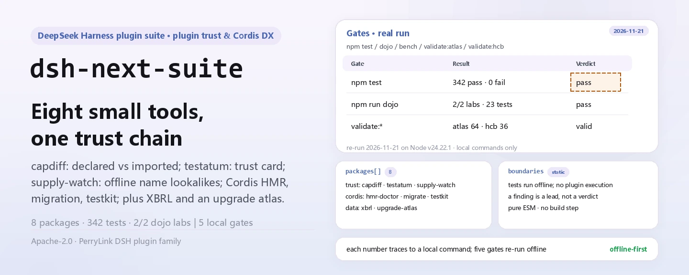
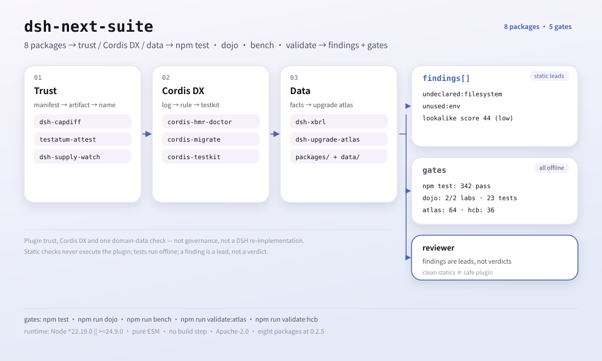

<div align="center">

<picture>
  <source media="(prefers-color-scheme: dark)" srcset="docs/assets/dsh-next-suite-hero-en-dark.webp">
  
</picture>

# dsh-next-suite

**Ocho herramientas pequeñas y componibles para el ecosistema de DeepSeek Harness / Cordis / agentes — confianza de plugins, experiencia de desarrollo con Cordis y una comprobación de datos de dominio.**

*Siete CLI y una biblioteca, ESM puro sin paso de compilación y con pruebas offline; cinco compuertas locales son la evidencia que cita este README. Además, tres artefactos que no son código: un dojo, un atlas del ecosistema y un plan de credenciales.*

[English](README.md) · [简体中文](README-zh.md) · Español · [Português](README-pt.md) · [हिन्दी](README-hi.md)

[](LICENSE)
[]()
[](https://github.com/PerryLink/dsh-next-suite/actions/workflows/ci.yml)

[Seguridad](SECURITY.md) · [Contribuir](CONTRIBUTING.md) · [Changelog](CHANGELOG.md)

</div>

---

> **Proyecto comunitario. Sin afiliación, patrocinio ni respaldo de DeepSeek.**
> Apache-2.0. Sin SLA ni garantía. MVP temprano, publicado como `0.2.5` en npm (2026-11-19).

Esta suite deliberadamente **no** es otro conjunto de paquetes de gobernanza. Cubre los huecos que quedaron después de [`dsh-os-suite`](../dsh-os-suite/): confianza de plugins, experiencia de desarrollo con Cordis y una comprobación de datos de dominio.

## Paquetes

| Paquete | Tipo | En una línea |
|---|---|---|
| [`dsh-capdiff`](packages/dsh-capdiff/) | CLI | `dsh.capabilities` declaradas frente a los imports reales del código del plugin; SARIF y manifest sugerido. |
| [`testatum-attest`](packages/testatum-attest/) | CLI | Tarjeta de confianza para artefactos de plugin: hashes de contenido, firma HMAC, revocación y verificación offline. |
| [`dsh-supply-watch`](packages/dsh-supply-watch/) | CLI | Comprobaciones offline de typosquatting, nombres parecidos y anomalías de versión en nombres npm. |
| [`cordis-hmr-doctor`](packages/cordis-hmr-doctor/) | CLI | Analiza logs de HMR de Cordis (`settled` / `aborted` / `skipped`) y explica qué pasó. |
| [`cordis-migrate`](packages/cordis-migrate/) | CLI | Motor de reglas para migrar Cordis 3→4: escaneo, dry-run y `--write` explícito. |
| [`cordis-testkit`](packages/cordis-testkit/) | library | Contexto Cordis simulado más aserciones de fugas de effects y listeners. |
| [`dsh-xbrl`](packages/dsh-xbrl/) | CLI | Conciliación offline de hechos XBRL y diff de reexpresiones. |
| [`dsh-upgrade-atlas`](packages/dsh-upgrade-atlas/) | CLI/data | Puntos de ruptura de actualización de DSH curados: consultar y renderizar Markdown. |


<picture>
  <source media="(prefers-color-scheme: dark)" srcset="docs/assets/dsh-next-suite-flow-v5-dark.svg">
  
</picture>

*Estructura: tres grupos — confianza, Cordis DX y datos — cada paquete es una CLI o una biblioteca, y una misma batería de cinco compuertas offline. Los `findings[]` de capdiff y supply-watch son pistas estáticas que confirma una persona revisora; testatum verifica offline una tarjeta firmada. Las etiquetas dentro del diagrama son los nombres reales de paquetes, compuertas y directorios, así que la misma imagen sirve para los cinco idiomas.*

## npm

- [dsh-capdiff](https://www.npmjs.com/package/dsh-capdiff)
- [testatum-attest](https://www.npmjs.com/package/testatum-attest)
- [dsh-supply-watch](https://www.npmjs.com/package/dsh-supply-watch)
- [cordis-hmr-doctor](https://www.npmjs.com/package/cordis-hmr-doctor)
- [cordis-migrate](https://www.npmjs.com/package/cordis-migrate)
- [cordis-testkit](https://www.npmjs.com/package/cordis-testkit)
- [dsh-xbrl](https://www.npmjs.com/package/dsh-xbrl)
- [dsh-upgrade-atlas](https://www.npmjs.com/package/dsh-upgrade-atlas)

## Artefactos que no son código

- [`CREDENTIALS.md`](CREDENTIALS.md) — plan de credenciales a 90 días (DOI, insignia OpenSSF, FSE'27, IETF/W3C, 职称). Ningún resultado inventado.
- [`DOJO.md`](DOJO.md) — dos laboratorios prácticos: Hello Plugin y Governance Lab, con criterios de aceptación.
- [`ECOSYSTEM-ATLAS.md`](ECOSYSTEM-ATLAS.md) — atlas del ecosistema con 64 entidades (JSON: [`data/ecosystem-atlas.json`](data/ecosystem-atlas.json)); no es un directorio exhaustivo, valida con `npm run validate:atlas`.
- [`data/hcb/`](data/hcb/) — **semilla** del conjunto de datos HCB de servicios del host, **36 filas** (6 paquetes × tres versiones: dos versiones semilla de la era 0.1.x y una instantánea `0.2.4`, cada una en Node `22.19.0`/`24.22.1`, host DSH `0.2.2-rc.3`). Es una semilla puntual, **no** el conjunto de datos DOI de HCB; el canónico es [`PerryLink/dsh-hcb`](https://github.com/PerryLink/dsh-hcb). `host_supported` marca las versiones de Node fuera del rango `engines.node` del host (sus celdas de install/dump son `unsupported`), y `not-tested` marca las comprobaciones sin evidencia. Valida con `npm run validate:hcb`.

## Estado (2026-11-15)

- **342/342 pruebas** en los ocho paquetes (`npm test`; la plantilla queda fuera de `packages/`).
- **Protección de rama**: `main` exige un PR, las comprobaciones CI/CodeQL y una rama al día; los force push y el borrado están bloqueados.
- **Procedencia de la release**: las releases de GitHub publicadas llevan un asset `.intoto.jsonl` generado a partir de attestations de npm (manual para `v0.2.4`+, automático para las futuras vía `.github/workflows/release-provenance.yml`).
- **Autenticación de release**: npm Trusted Publishing (OIDC), verificado con la release `v0.2.5`; el secret `NPM_TOKEN` heredado se ha eliminado. Pasos e historial: [`docs/trusted-publishing.md`](docs/trusted-publishing.md).
- **Compuerta de cobertura**: lines 85% / functions 80% / branches 70% (`npm run test:coverage`).
- **19 archivos `src/*.js`** pasan `node --check`.
- **Datos**: la semilla local de HCB tiene **36 filas** (6 paquetes × tres versiones: dos versiones semilla de la era 0.1.x y una instantánea `0.2.4`, en Node `22.19.0`/`24.22.1`; las filas de Node 22 son `host_supported=false` con install/dump `unsupported`) y no es el conjunto de datos DOI (canónico: [`dsh-hcb`](https://github.com/PerryLink/dsh-hcb)); el atlas de actualizaciones tiene **50 entradas**, **49** con una release `to` concreta y **1** marcada como `target unknown`.
- **8/8 nombres** se verificaron libres antes de publicar (npm E404, GitHub 0); ahora los ocho están publicados bajo este proyecto.
- **Auditoría previa a la release**: [`AUDIT.md`](AUDIT.md) (histórica, 0.1.x); las correcciones de contrato se registran en `CONTRACT-FIX.md`.
- **Publicado**: los ocho paquetes en `0.2.5` en npm (2026-11-19); repositorio de GitHub y release `v0.2.5`.

## Inicio rápido


*Animado: stdout real de `npm test` (resumen del reporter TAP), `npm run dojo` y `npm run bench` el 2026-11-21 (Node v24.22.1). El resumen de pruebas pasa por el reporter TAP de Node para que cada línea sea ASCII puro; los números de benchmark describen solo los dos corpus curados.*


```sh
npm test

node packages/dsh-capdiff/src/cli.js --help
node packages/dsh-xbrl/src/cli.js check facts.json
```

## Reglas de diseño

- JavaScript ESM puro + JSDoc, sin build; Node `^22.19.0 || >=24.9.0`.
- `src/core.js` no importa paquetes de terceros; las pruebas se ejecutan offline.
- Las CLI son finas: parsean argumentos, llaman al core e imprimen. `--json` devuelve un sobre de objeto.
- Sin red, sin secretos y sin escrituras destructivas por defecto (`cordis-migrate` usa dry-run por defecto).
- Cada README indica lo que la herramienta **no** es.

## Licencia

Apache-2.0.
