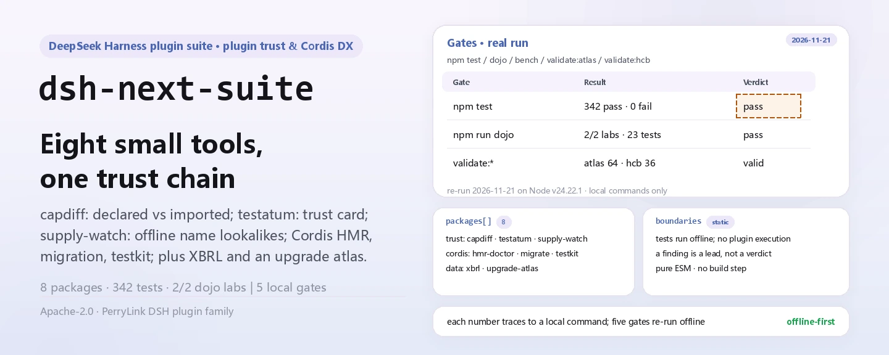
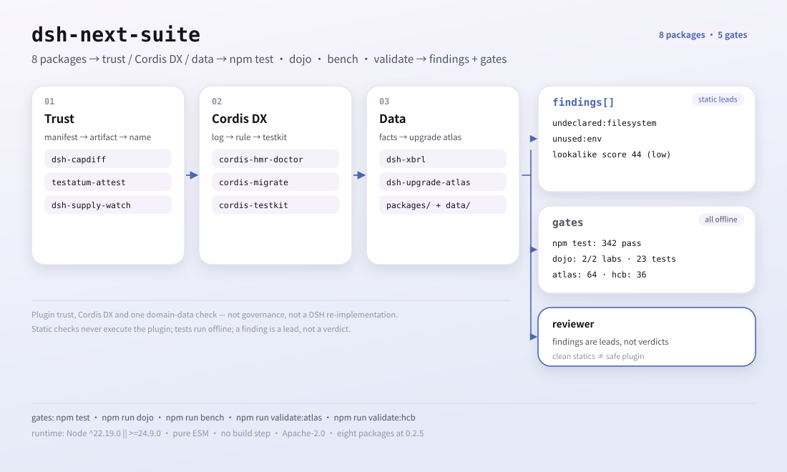
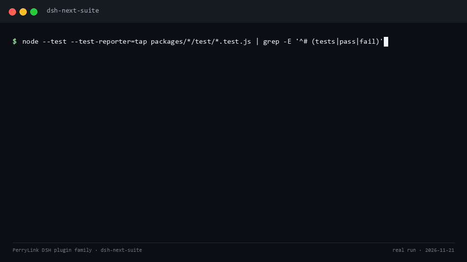

<div align="center">

<picture>
  <source media="(prefers-color-scheme: dark)" srcset="docs/assets/dsh-next-suite-hero-en-dark.webp">
  
</picture>

# dsh-next-suite

**DeepSeek Harness / Cordis / agent-plugin इकोसिस्टम के लिए आठ छोटे, जोड़े जा सकने वाले टूल — plugin भरोसा, Cordis डेवलपर अनुभव और एक domain-data जाँच।**

*सात CLI और एक library, शुद्ध ESM, कोई build चरण नहीं और परीक्षण offline; पाँच स्थानीय gates ही वह साक्ष्य हैं जिन्हें यह README उद्धृत करता है। साथ में तीन गैर-कोड कलाकृतियाँ: एक dojo, एक इकोसिस्टम atlas और एक credential योजना।*

[English](README.md) · [简体中文](README-zh.md) · [Español](README-es.md) · [Português](README-pt.md) · हिन्दी

[](LICENSE)
[]()
[](https://github.com/PerryLink/dsh-next-suite/actions/workflows/ci.yml)

[सुरक्षा](SECURITY.md) · [योगदान](CONTRIBUTING.md) · [Changelog](CHANGELOG.md)

</div>

---

> **सामुदायिक परियोजना। DeepSeek से कोई संबद्धता, प्रायोजन या समर्थन नहीं।**
> Apache-2.0. कोई SLA नहीं, कोई वारंटी नहीं। शुरुआती MVP, npm पर `0.2.5` के रूप में प्रकाशित (2026-11-19)।

यह सूट जानबूझकर **कोई** दूसरा governance पैकेज-समूह नहीं है। यह [`dsh-os-suite`](../dsh-os-suite/) के बाद बची खाली जगहों को भरता है: plugin भरोसा, Cordis डेवलपर अनुभव और एक domain-data जाँच।

## पैकेज

| पैकेज | प्रकार | एक पंक्ति में |
|---|---|---|
| [`dsh-capdiff`](packages/dsh-capdiff/) | CLI | plugin कोड के वास्तविक imports बनाम घोषित `dsh.capabilities`; SARIF + सुझाया गया manifest। |
| [`testatum-attest`](packages/testatum-attest/) | CLI | plugin artifacts के लिए trust card: content hashes, HMAC हस्ताक्षर, revocation और offline सत्यापन। |
| [`dsh-supply-watch`](packages/dsh-supply-watch/) | CLI | npm नामों के लिए offline typosquat / मिलते-जुलते नाम / version-anomaly जाँच। |
| [`cordis-hmr-doctor`](packages/cordis-hmr-doctor/) | CLI | Cordis HMR लॉग (`settled` / `aborted` / `skipped`) पढ़कर बताता है कि क्या हुआ। |
| [`cordis-migrate`](packages/cordis-migrate/) | CLI | Cordis 3→4 माइग्रेशन नियम-इंजन: scan, dry-run, स्पष्ट `--write`। |
| [`cordis-testkit`](packages/cordis-testkit/) | library | Cordis mock context और effect/listener leak assertions। |
| [`dsh-xbrl`](packages/dsh-xbrl/) | CLI | offline XBRL fact reconciliation और restatement diff। |
| [`dsh-upgrade-atlas`](packages/dsh-upgrade-atlas/) | CLI/data | क्यूरेट किए गए DSH अपग्रेड breakpoints: query करें और Markdown बनाएँ। |


<picture>
  <source media="(prefers-color-scheme: dark)" srcset="docs/assets/dsh-next-suite-flow-v5-dark.svg">
  
</picture>

*संरचना: तीन समूह — भरोसा, Cordis DX और डेटा — हर पैकेज एक CLI या एक library है, और पाँच offline gates का एक ही सेट आगे जाता है। capdiff और supply-watch के `findings[]` ऐसे स्थिर संकेत हैं जिन्हें समीक्षक पुष्ट करता है; testatum हस्ताक्षरित card को offline सत्यापित करता है। आरेख के भीतर केवल असली पैकेज, gate और directory नाम हैं, इसलिए एक ही चित्र पाँचों भाषाओं के लिए काम आता है।*

## npm

- [dsh-capdiff](https://www.npmjs.com/package/dsh-capdiff)
- [testatum-attest](https://www.npmjs.com/package/testatum-attest)
- [dsh-supply-watch](https://www.npmjs.com/package/dsh-supply-watch)
- [cordis-hmr-doctor](https://www.npmjs.com/package/cordis-hmr-doctor)
- [cordis-migrate](https://www.npmjs.com/package/cordis-migrate)
- [cordis-testkit](https://www.npmjs.com/package/cordis-testkit)
- [dsh-xbrl](https://www.npmjs.com/package/dsh-xbrl)
- [dsh-upgrade-atlas](https://www.npmjs.com/package/dsh-upgrade-atlas)

## गैर-कोड कलाकृतियाँ

- [`CREDENTIALS.md`](CREDENTIALS.md) — 90 दिन की credential योजना (DOI, OpenSSF बैज, FSE'27, IETF/W3C, 职称)। कोई गढ़ा हुआ परिणाम नहीं।
- [`DOJO.md`](DOJO.md) — दो प्रैक्टिकल लैब: Hello Plugin और Governance Lab, स्वीकृति मानदंड के साथ।
- [`ECOSYSTEM-ATLAS.md`](ECOSYSTEM-ATLAS.md) — 64-entity इकोसिस्टम atlas (JSON: [`data/ecosystem-atlas.json`](data/ecosystem-atlas.json)); यह पूरी सूची नहीं है, `npm run validate:atlas` से सत्यापित करें।
- [`data/hcb/`](data/hcb/) — HCB host-service **seed** डेटासेट, **36 पंक्तियाँ** (6 पैकेज × तीन versions: 0.1.x युग के दो seed versions + एक `0.2.4` snapshot, हर एक Node `22.19.0`/`24.22.1`, host DSH `0.2.2-rc.3` पर)। यह एक समय-बिंदु का seed है, **नहीं** HCB DOI डेटासेट; असली डेटासेट [`PerryLink/dsh-hcb`](https://github.com/PerryLink/dsh-hcb) है। `host_supported` उन Node versions को चिह्नित करता है जो host के `engines.node` दायरे से बाहर हैं (उनकी install/dump कोशिकाएँ `unsupported` हैं), और `not-tested` उन जाँचों को चिह्नित करता है जिनका कोई साक्ष्य नहीं है। `npm run validate:hcb` से सत्यापित करें।

## स्थिति (2026-11-15)

- **342/342 टेस्ट** आठों पैकेजों में (`npm test`; template `packages/` के बाहर है)।
- **Branch protection**: `main` के लिए PR, CI/CodeQL जाँचें और अद्यतन branch आवश्यक; force push और deletion अवरुद्ध हैं।
- **Release provenance**: प्रकाशित GitHub releases के साथ npm attestations से बना `.intoto.jsonl` asset आता है (`v0.2.4`+ के लिए मैनुअल, आगे के लिए `.github/workflows/release-provenance.yml` द्वारा स्वचालित)।
- **Release auth**: npm Trusted Publishing (OIDC), `v0.2.5` release से सत्यापित; पुराना `NPM_TOKEN` secret हटा दिया गया है। चरण/इतिहास: [`docs/trusted-publishing.md`](docs/trusted-publishing.md)।
- **Coverage gate**: lines 85% / functions 80% / branches 70% (`npm run test:coverage`)।
- **19 `src/*.js` फ़ाइलें** `node --check` पास करती हैं।
- **डेटा**: स्थानीय HCB seed में **36 पंक्तियाँ** हैं (6 पैकेज × तीन versions: 0.1.x युग के दो seed versions + एक `0.2.4` snapshot, Node `22.19.0`/`24.22.1` पर; Node 22 की पंक्तियाँ `host_supported=false` हैं और उनकी install/dump `unsupported` है) और यह DOI डेटासेट नहीं है (असली: [`dsh-hcb`](https://github.com/PerryLink/dsh-hcb)); upgrade atlas में **50 entries** हैं, **49** के पास ठोस `to` release है और **1** `target unknown` चिह्नित है।
- **8/8 नाम** प्रकाशन से पहले मुक्त सत्यापित किए गए (npm E404, GitHub 0); अब सभी आठ इस परियोजना के अंतर्गत प्रकाशित हैं।
- **Pre-release audit**: [`AUDIT.md`](AUDIT.md) (ऐतिहासिक, 0.1.x); contract सुधार `CONTRACT-FIX.md` में दर्ज हैं।
- **प्रकाशित**: सभी आठ पैकेज npm पर `0.2.5` (2026-11-19); GitHub repo और `v0.2.5` release।

## त्वरित शुरुआत



*एनिमेटेड: 2026-11-21 (Node v24.22.1) पर `npm test` (TAP reporter सारांश), `npm run dojo` और `npm run bench` का असली stdout। परीक्षण-सारांश Node के TAP reporter से जाता है ताकि हर पंक्ति शुद्ध ASCII हो; benchmark संख्याएँ केवल इन दो क्यूरेट किए गए corpus का वर्णन करती हैं।*


```sh
npm test

node packages/dsh-capdiff/src/cli.js --help
node packages/dsh-xbrl/src/cli.js check facts.json
```

## डिज़ाइन नियम

- शुद्ध ESM JavaScript + JSDoc, कोई build नहीं; Node `^22.19.0 || >=24.9.0`।
- `src/core.js` कोई third-party पैकेज import नहीं करता; परीक्षण offline चलते हैं।
- CLI पतले हैं: arguments पढ़ो, core बुलाओ, print करो। `--json` एक object envelope लौटाता है।
- डिफ़ॉल्ट में कोई नेटवर्क नहीं, कोई secret नहीं, कोई destructive write नहीं (`cordis-migrate` डिफ़ॉल्ट dry-run है)।
- हर README बताता है कि यह टूल **क्या नहीं** है।

## लाइसेंस

Apache-2.0।
