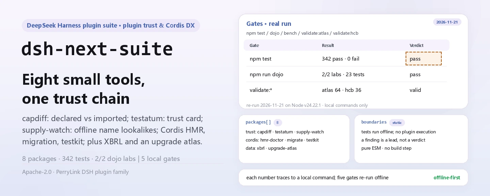
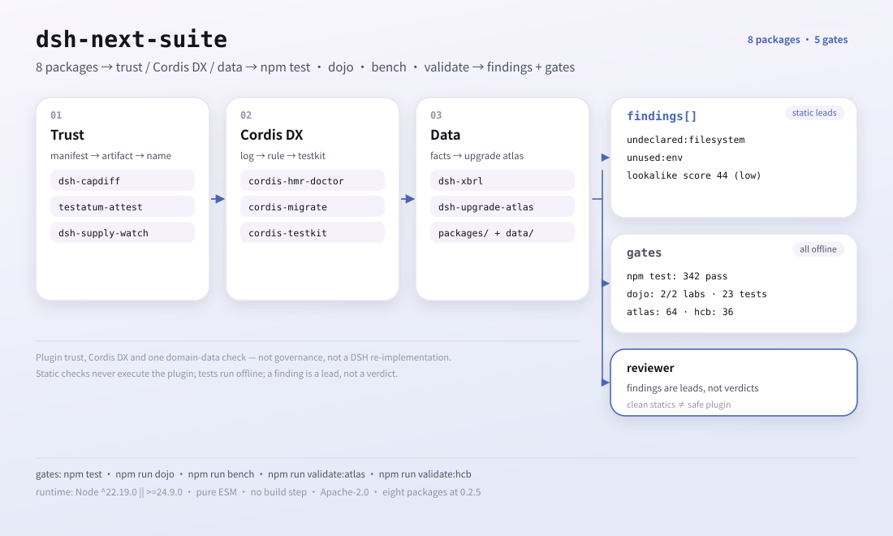

<div align="center">

<picture>
  <source media="(prefers-color-scheme: dark)" srcset="docs/assets/dsh-next-suite-hero-en-dark.webp">
  
</picture>

# dsh-next-suite

**Oito ferramentas pequenas e combináveis para o ecossistema DeepSeek Harness / Cordis / agentes — confiança de plugins, experiência de desenvolvimento com Cordis e uma verificação de dados de domínio.**

*Sete CLIs e uma biblioteca, ESM puro sem etapa de build e com testes offline; cinco portões locais são a evidência citada neste README. Além disso, três artefatos que não são código: um dojo, um atlas do ecossistema e um plano de credenciais.*

[English](README.md) · [简体中文](README-zh.md) · [Español](README-es.md) · Português · [हिन्दी](README-hi.md)

[](LICENSE)
[]()
[](https://github.com/PerryLink/dsh-next-suite/actions/workflows/ci.yml)

[Segurança](SECURITY.md) · [Contribuir](CONTRIBUTING.md) · [Changelog](CHANGELOG.md)

</div>

---

> **Projeto comunitário. Sem afiliação, patrocínio ou endosso do DeepSeek.**
> Apache-2.0. Sem SLA, sem garantia. MVP inicial, publicado como `0.2.5` no npm (2026-11-19).

Esta suíte deliberadamente **não** é outro conjunto de pacotes de governança. Ela cobre as lacunas deixadas após o [`dsh-os-suite`](../dsh-os-suite/): confiança de plugins, experiência de desenvolvimento com Cordis e uma verificação de dados de domínio.

## Pacotes

| Pacote | Tipo | Em uma linha |
|---|---|---|
| [`dsh-capdiff`](packages/dsh-capdiff/) | CLI | `dsh.capabilities` declaradas versus imports reais no código do plugin; SARIF + manifest sugerido. |
| [`testatum-attest`](packages/testatum-attest/) | CLI | Cartão de confiança para artefatos de plugin: hashes de conteúdo, assinatura HMAC, revogação e verificação offline. |
| [`dsh-supply-watch`](packages/dsh-supply-watch/) | CLI | Verificações offline de typosquatting, nomes parecidos e anomalias de versão em nomes npm. |
| [`cordis-hmr-doctor`](packages/cordis-hmr-doctor/) | CLI | Analisa logs de HMR do Cordis (`settled` / `aborted` / `skipped`) e explica o que aconteceu. |
| [`cordis-migrate`](packages/cordis-migrate/) | CLI | Motor de regras para migrar Cordis 3→4: scan, dry-run e `--write` explícito. |
| [`cordis-testkit`](packages/cordis-testkit/) | library | Contexto Cordis simulado mais asserções de vazamento de effects e listeners. |
| [`dsh-xbrl`](packages/dsh-xbrl/) | CLI | Conciliação offline de fatos XBRL e diff de reapresentações. |
| [`dsh-upgrade-atlas`](packages/dsh-upgrade-atlas/) | CLI/data | Pontos de ruptura de atualização do DSH curados: consultar e renderizar Markdown. |


<picture>
  <source media="(prefers-color-scheme: dark)" srcset="docs/assets/dsh-next-suite-flow-v5-dark.svg">
  
</picture>

*Estrutura: três grupos — confiança, Cordis DX e dados — cada pacote é uma CLI ou uma biblioteca, e um mesmo conjunto de cinco portões offline. Os `findings[]` do capdiff e do supply-watch são pistas estáticas que uma pessoa revisora confirma; o testatum verifica offline um cartão assinado. Os rótulos dentro do diagrama são os nomes reais de pacotes, portões e diretórios, então a mesma imagem serve aos cinco idiomas.*

## npm

- [dsh-capdiff](https://www.npmjs.com/package/dsh-capdiff)
- [testatum-attest](https://www.npmjs.com/package/testatum-attest)
- [dsh-supply-watch](https://www.npmjs.com/package/dsh-supply-watch)
- [cordis-hmr-doctor](https://www.npmjs.com/package/cordis-hmr-doctor)
- [cordis-migrate](https://www.npmjs.com/package/cordis-migrate)
- [cordis-testkit](https://www.npmjs.com/package/cordis-testkit)
- [dsh-xbrl](https://www.npmjs.com/package/dsh-xbrl)
- [dsh-upgrade-atlas](https://www.npmjs.com/package/dsh-upgrade-atlas)

## Artefatos que não são código

- [`CREDENTIALS.md`](CREDENTIALS.md) — plano de credenciais de 90 dias (DOI, selo OpenSSF, FSE'27, IETF/W3C, 职称). Nenhum resultado inventado.
- [`DOJO.md`](DOJO.md) — dois laboratórios práticos: Hello Plugin e Governance Lab, com critérios de aceitação.
- [`ECOSYSTEM-ATLAS.md`](ECOSYSTEM-ATLAS.md) — atlas do ecossistema com 64 entidades (JSON: [`data/ecosystem-atlas.json`](data/ecosystem-atlas.json)); não é um diretório exaustivo, valide com `npm run validate:atlas`.
- [`data/hcb/`](data/hcb/) — **semente** do conjunto de dados HCB de serviços do host, **36 linhas** (6 pacotes × três versões: duas versões semente da era 0.1.x e um snapshot `0.2.4`, cada uma em Node `22.19.0`/`24.22.1`, host DSH `0.2.2-rc.3`). É uma semente pontual, **não** o conjunto de dados DOI do HCB; o canônico é [`PerryLink/dsh-hcb`](https://github.com/PerryLink/dsh-hcb). `host_supported` marca as versões de Node fora do intervalo `engines.node` do host (suas células de install/dump são `unsupported`), e `not-tested` marca verificações sem evidência. Valide com `npm run validate:hcb`.

## Estado (2026-11-15)

- **342/342 testes** nos oito pacotes (`npm test`; o template fica fora de `packages/`).
- **Proteção de branch**: `main` exige um PR, as verificações CI/CodeQL e uma branch atualizada; force push e exclusão estão bloqueados.
- **Procedência da release**: as releases publicadas no GitHub carregam um asset `.intoto.jsonl` gerado a partir de attestations do npm (manual para `v0.2.4`+, automático para as futuras via `.github/workflows/release-provenance.yml`).
- **Autenticação de release**: npm Trusted Publishing (OIDC), verificado pela release `v0.2.5`; o secret `NPM_TOKEN` legado foi removido. Passos e histórico: [`docs/trusted-publishing.md`](docs/trusted-publishing.md).
- **Portão de cobertura**: lines 85% / functions 80% / branches 70% (`npm run test:coverage`).
- **19 arquivos `src/*.js`** passam em `node --check`.
- **Dados**: a semente local do HCB tem **36 linhas** (6 pacotes × três versões: duas versões semente da era 0.1.x e um snapshot `0.2.4`, em Node `22.19.0`/`24.22.1`; as linhas de Node 22 são `host_supported=false` com install/dump `unsupported`) e não é o conjunto de dados DOI (canônico: [`dsh-hcb`](https://github.com/PerryLink/dsh-hcb)); o atlas de atualizações tem **50 entradas**, **49** com uma release `to` concreta e **1** marcada como `target unknown`.
- **8/8 nomes** foram verificados como livres antes de publicar (npm E404, GitHub 0); agora todos os oito estão publicados sob este projeto.
- **Auditoria pré-release**: [`AUDIT.md`](AUDIT.md) (histórica, 0.1.x); as correções de contrato são registradas em `CONTRACT-FIX.md`.
- **Publicado**: os oito pacotes em `0.2.5` no npm (2026-11-19); repositório do GitHub e release `v0.2.5`.

## Início rápido


*Animado: stdout real de `npm test` (resumo do reporter TAP), `npm run dojo` e `npm run bench` em 2026-11-21 (Node v24.22.1). O resumo dos testes passa pelo reporter TAP do Node para que cada linha seja ASCII puro; os números de benchmark descrevem apenas os dois corpus curados.*


```sh
npm test

node packages/dsh-capdiff/src/cli.js --help
node packages/dsh-xbrl/src/cli.js check facts.json
```

## Regras de design

- JavaScript ESM puro + JSDoc, sem build; Node `^22.19.0 || >=24.9.0`.
- `src/core.js` não importa pacotes de terceiros; os testes rodam offline.
- As CLIs são finas: parseiam argumentos, chamam o core e imprimem. `--json` devolve um envelope de objeto.
- Sem rede, sem segredos e sem escritas destrutivas por padrão (`cordis-migrate` usa dry-run por padrão).
- Cada README diz o que a ferramenta **não** é.

## Licença

Apache-2.0.
