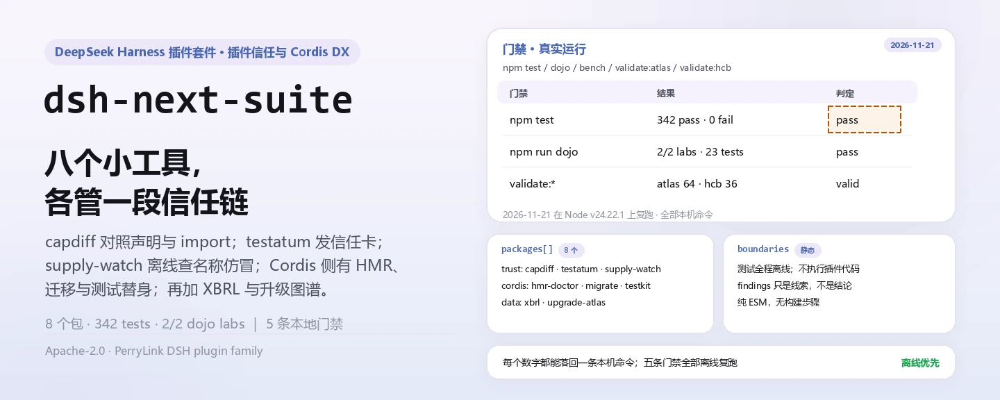
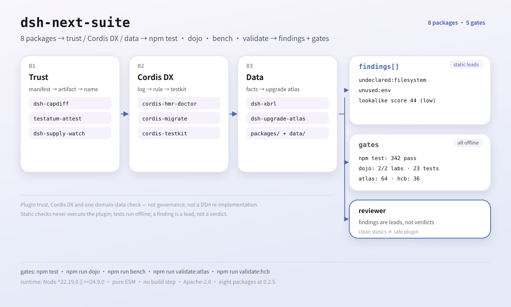
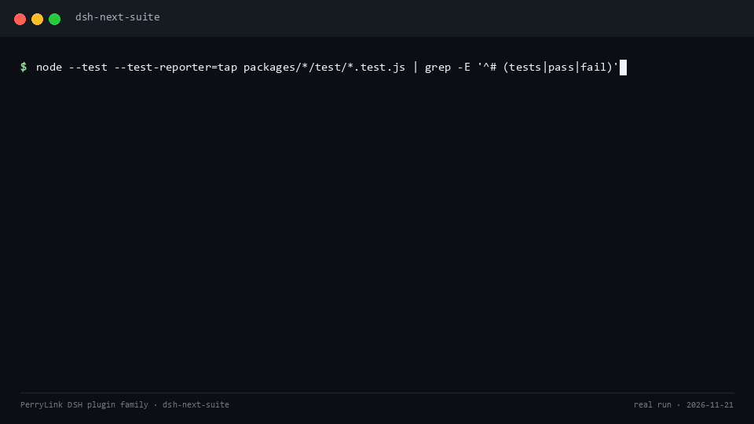

<div align="center">

<picture>
  <source media="(prefers-color-scheme: dark)" srcset="docs/assets/dsh-next-suite-hero-zh-dark.webp">
  
</picture>

# dsh-next-suite

**八个可组合的小工具，面向 DeepSeek Harness / Cordis / agent-plugin 生态 —— 插件信任、Cordis 开发体验，以及一个领域数据检查。**

*七个 CLI 加一个库，纯 ESM、无构建步骤、测试离线；五条本地门禁是下文引用的证据。另有三份非代码产出：一个 dojo、一份生态图谱和一份凭据计划。*

[English](README.md) · 简体中文 · [Español](README-es.md) · [Português](README-pt.md) · [हिन्दी](README-hi.md)

[](LICENSE)
[]()
[](https://github.com/PerryLink/dsh-next-suite/actions/workflows/ci.yml)

[安全](SECURITY.md) · [贡献](CONTRIBUTING.md) · [更新日志](CHANGELOG.md)

</div>

---

> **社区项目，与 DeepSeek 无隶属关系，未获其赞助或背书。**
> Apache-2.0，无 SLA、无担保。早期 MVP，已在 npm 发布 `0.2.5`（2026-11-19）。

本套件刻意**不做**又一套治理包。它补的是 [`dsh-os-suite`](../dsh-os-suite/) 之后留下的缺口：插件信任、Cordis 开发体验，以及一个领域数据检查。

## 包

| 包 | 类型 | 一句话 |
|---|---|---|
| [`dsh-capdiff`](packages/dsh-capdiff/) | CLI | 对照插件代码里真实的 import 与声明的 `dsh.capabilities`；输出 SARIF 与建议的 manifest。 |
| [`testatum-attest`](packages/testatum-attest/) | CLI | 给插件产物发信任卡：内容哈希、HMAC 签名、撤销列表、离线验签。 |
| [`dsh-supply-watch`](packages/dsh-supply-watch/) | CLI | 离线检查 npm 名称仿冒、近似名与版本异常。 |
| [`cordis-hmr-doctor`](packages/cordis-hmr-doctor/) | CLI | 解析 Cordis HMR 日志（`settled` / `aborted` / `skipped`），解释发生了什么。 |
| [`cordis-migrate`](packages/cordis-migrate/) | CLI | Cordis 3→4 迁移规则引擎：扫描、dry-run、显式 `--write`。 |
| [`cordis-testkit`](packages/cordis-testkit/) | library | Mock Cordis context，加上 effect/listener 泄漏断言。 |
| [`dsh-xbrl`](packages/dsh-xbrl/) | CLI | 离线的 XBRL 事实勾稽与重述差异比较。 |
| [`dsh-upgrade-atlas`](packages/dsh-upgrade-atlas/) | CLI/data | 经过整理的 DSH 升级断点：查询并渲染 Markdown。 |


<picture>
  <source media="(prefers-color-scheme: dark)" srcset="docs/assets/dsh-next-suite-flow-v5-dark.svg">
  
</picture>

*结构：三组 —— 信任、Cordis DX、数据 —— 每个包是一个 CLI 或一个库，出口是同一套五条离线门禁。capdiff 与 supply-watch 的 `findings[]` 是待人复核的静态线索，testatum 的信任卡离线验签；图内只有真实的包名、门禁命令与目录名，五语共用同一张结构图。*

## npm

- [dsh-capdiff](https://www.npmjs.com/package/dsh-capdiff)
- [testatum-attest](https://www.npmjs.com/package/testatum-attest)
- [dsh-supply-watch](https://www.npmjs.com/package/dsh-supply-watch)
- [cordis-hmr-doctor](https://www.npmjs.com/package/cordis-hmr-doctor)
- [cordis-migrate](https://www.npmjs.com/package/cordis-migrate)
- [cordis-testkit](https://www.npmjs.com/package/cordis-testkit)
- [dsh-xbrl](https://www.npmjs.com/package/dsh-xbrl)
- [dsh-upgrade-atlas](https://www.npmjs.com/package/dsh-upgrade-atlas)

## 非代码产出

- [`CREDENTIALS.md`](CREDENTIALS.md) —— 90 天凭据计划（DOI、OpenSSF 徽章、FSE'27、IETF/W3C、职称）。不捏造任何结果。
- [`DOJO.md`](DOJO.md) —— 两个动手实验：Hello Plugin 与 Governance Lab，各带验收标准。
- [`ECOSYSTEM-ATLAS.md`](ECOSYSTEM-ATLAS.md) —— 64 条实体的生态图谱（JSON：[`data/ecosystem-atlas.json`](data/ecosystem-atlas.json)），不是穷尽目录；用 `npm run validate:atlas` 校验。
- [`data/hcb/`](data/hcb/) —— HCB 宿主服务**种子**数据集，**36 行**（6 个包 × 三个版本：两个 0.1.x 时代种子版本 + 一个 `0.2.4` 快照，各自在 Node `22.19.0`/`24.22.1`、宿主 DSH `0.2.2-rc.3` 上）。这是某个时间点的种子，**不是** HCB DOI 数据集；权威数据集是 [`PerryLink/dsh-hcb`](https://github.com/PerryLink/dsh-hcb)。`host_supported` 标出宿主 `engines.node` 范围之外的 Node 版本（其 install/dump 单元格记为 `unsupported`），`not-tested` 标出没有证据的检查。用 `npm run validate:hcb` 校验。

## 状态（2026-11-15）

- **342/342 个测试**（`npm test`）覆盖八个包；模板不在 `packages/` 内。
- **分支保护**：`main` 要求 PR、CI/CodeQL 检查，且分支保持最新；禁止 force push 与删除。
- **发布溯源**：已发布的 GitHub release 带一个由 npm attestation 生成的 `.intoto.jsonl` 资产（`v0.2.4`+ 为手工，之后由 `.github/workflows/release-provenance.yml` 自动生成）。
- **发布认证**：npm Trusted Publishing（OIDC），已由 `v0.2.5` 发布验证；旧的 `NPM_TOKEN` secret 已移除。步骤/历史：[`docs/trusted-publishing.md`](docs/trusted-publishing.md)。
- **覆盖率门禁**：lines 85% / functions 80% / branches 70%（`npm run test:coverage`）。
- **19 个 `src/*.js` 文件**通过 `node --check`。
- **数据**：本地 HCB 种子有 **36 行**（6 个包 × 三个版本：两个 0.1.x 时代种子版本 + 一个 `0.2.4` 快照，在 Node `22.19.0`/`24.22.1` 上；Node 22 行是 `host_supported=false`，install/dump 记为 `unsupported`），不是 DOI 数据集（权威：[`dsh-hcb`](https://github.com/PerryLink/dsh-hcb)）；升级图谱有 **50 条**，其中 **49** 条带具体 `to` 版本，**1** 条标为 `target unknown`。
- **8/8 个名字**发布前核实可用（npm E404、GitHub 0）；现在都已在本项目下发布。
- **发布前审计**：[`AUDIT.md`](AUDIT.md)（历史，0.1.x）；契约修复记录在 `CONTRACT-FIX.md`。
- **已发布**：八个包全部在 npm 上为 `0.2.5`（2026-11-19）；GitHub 仓库与 `v0.2.5` release 已就绪。

## 快速开始



*动图是 2026-11-21 在本机真实运行的 `npm test`（TAP reporter 汇总）、`npm run dojo` 与 `npm run bench` 输出（Node v24.22.1）。测试汇总通过 Node 的 TAP reporter 输出，因此每一行都是纯 ASCII；基准数字只描述这两套人工挑选的语料。*


```sh
npm test

node packages/dsh-capdiff/src/cli.js --help
node packages/dsh-xbrl/src/cli.js check facts.json
```

## 设计规则

- 纯 ESM JavaScript + JSDoc，无构建步骤；Node `^22.19.0 || >=24.9.0`。
- `src/core.js` 不 import 任何第三方包；测试离线运行。
- CLI 很薄：解析参数、调用 core、打印。`--json` 返回一个对象信封。
- 默认不联网、不碰密钥、不做破坏性写入（`cordis-migrate` 默认 dry-run）。
- 每个 README 都写明这个工具**不是**什么。

## 许可证

Apache-2.0。
