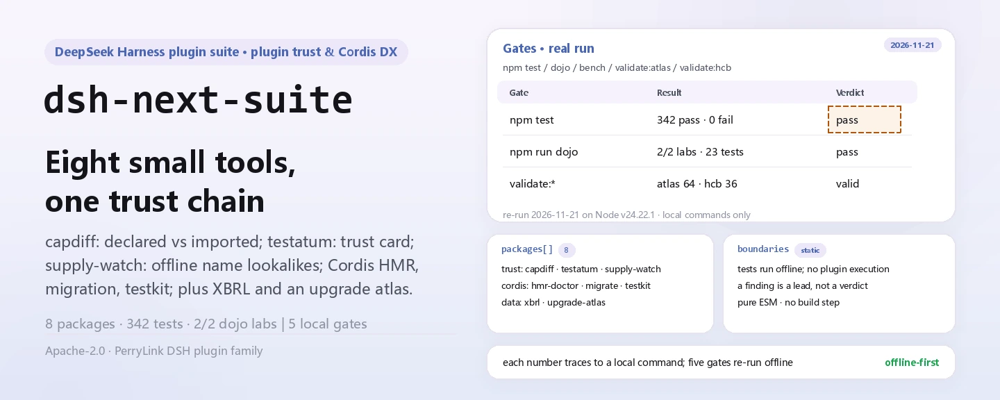
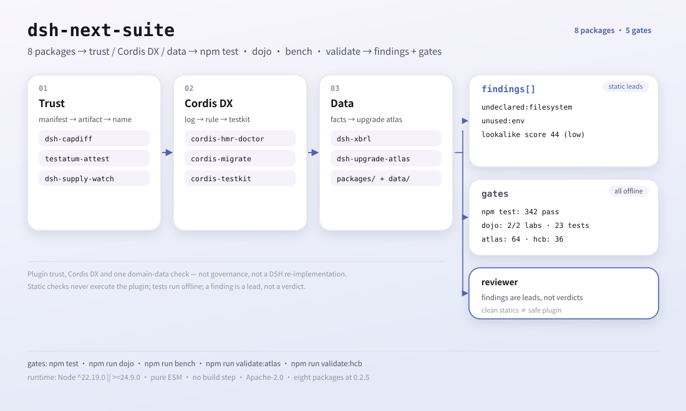
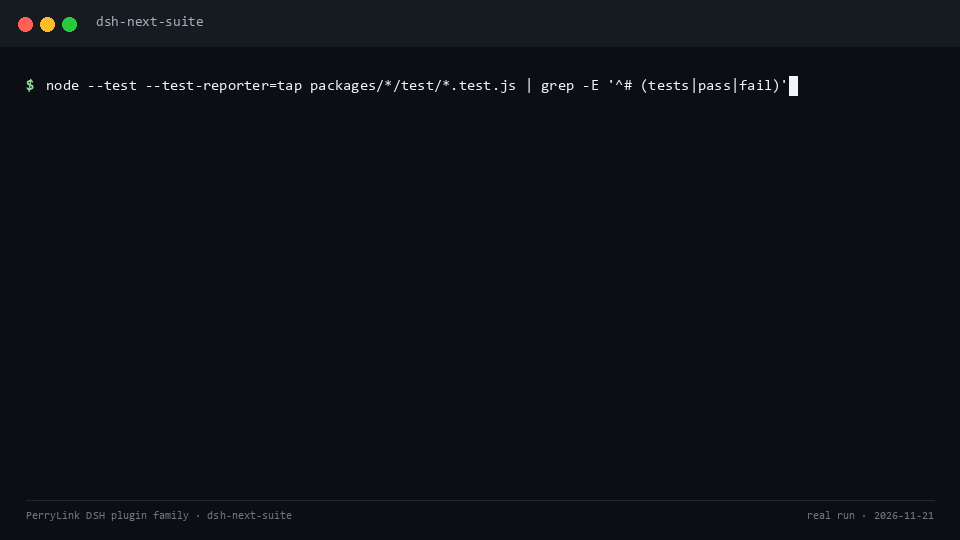

<div align="center">

<picture>
  <source media="(prefers-color-scheme: dark)" srcset="docs/assets/dsh-next-suite-hero-en-dark.webp">
  
</picture>

# dsh-next-suite

**Eight small, composable tools for the DeepSeek Harness / Cordis / agent-plugin ecosystem — plugin trust, Cordis developer experience, and one domain-data check.**

*Seven CLIs and one library, pure ESM with no build step and offline tests; five local gates are the evidence quoted below. Plus three non-code artifacts: a dojo, an ecosystem atlas and a credential plan.*

English · [简体中文](README-zh.md) · [Español](README-es.md) · [Português](README-pt.md) · [हिन्दी](README-hi.md)

[](LICENSE)
[]()
[](https://github.com/PerryLink/dsh-next-suite/actions/workflows/ci.yml)

[Security](SECURITY.md) · [Contributing](CONTRIBUTING.md) · [Changelog](CHANGELOG.md)

</div>

---

> **Community project. Not affiliated with, sponsored by, or endorsed by DeepSeek.**
> Apache-2.0. No SLA, no warranty. Early MVP, published as `0.2.5` on npm (2026-11-19).

This suite is deliberately **not** another set of governance packages. It targets the gaps left after [`dsh-os-suite`](../dsh-os-suite/): plugin trust, Cordis developer experience, and a domain-data check.

## Packages

| Package | Type | One-liner |
|---|---|---|
| [`dsh-capdiff`](packages/dsh-capdiff/) | CLI | Declared `dsh.capabilities` vs actual imports in plugin code; SARIF + suggested manifest. |
| [`testatum-attest`](packages/testatum-attest/) | CLI | Trust card for plugin artifacts: content hashes, HMAC signature, revocation, offline verify. |
| [`dsh-supply-watch`](packages/dsh-supply-watch/) | CLI | Offline typosquat / lookalike / version-anomaly checks for npm names. |
| [`cordis-hmr-doctor`](packages/cordis-hmr-doctor/) | CLI | Parse Cordis HMR logs (`settled` / `aborted` / `skipped`) and explain what happened. |
| [`cordis-migrate`](packages/cordis-migrate/) | CLI | Cordis 3→4 migration rule engine: scan, dry-run, explicit `--write`. |
| [`cordis-testkit`](packages/cordis-testkit/) | library | Mock Cordis context plus effect/listener leak assertions. |
| [`dsh-xbrl`](packages/dsh-xbrl/) | CLI | Offline XBRL fact reconciliation and restatement diff. |
| [`dsh-upgrade-atlas`](packages/dsh-upgrade-atlas/) | CLI/data | Curated DSH upgrade breakpoints: query and render Markdown. |


<picture>
  <source media="(prefers-color-scheme: dark)" srcset="docs/assets/dsh-next-suite-flow-v5-dark.svg">
  
</picture>

*Structure: three groups — trust, Cordis DX and data — each package a CLI or a library, and one shared set of five offline gates. `findings[]` from capdiff and supply-watch are static leads a reviewer confirms; testatum verifies a signed card offline. The token labels inside the diagram are the real package, gate and directory names, so the same picture serves all five languages.*

## npm

- [dsh-capdiff](https://www.npmjs.com/package/dsh-capdiff)
- [testatum-attest](https://www.npmjs.com/package/testatum-attest)
- [dsh-supply-watch](https://www.npmjs.com/package/dsh-supply-watch)
- [cordis-hmr-doctor](https://www.npmjs.com/package/cordis-hmr-doctor)
- [cordis-migrate](https://www.npmjs.com/package/cordis-migrate)
- [cordis-testkit](https://www.npmjs.com/package/cordis-testkit)
- [dsh-xbrl](https://www.npmjs.com/package/dsh-xbrl)
- [dsh-upgrade-atlas](https://www.npmjs.com/package/dsh-upgrade-atlas)

## Non-code artifacts

- [`CREDENTIALS.md`](CREDENTIALS.md) — 90-day credential plan (DOI, OpenSSF badge, FSE'27, IETF/W3C, 职称). No fabricated results.
- [`DOJO.md`](DOJO.md) — two hands-on labs: Hello Plugin and Governance Lab, with acceptance criteria.
- [`ECOSYSTEM-ATLAS.md`](ECOSYSTEM-ATLAS.md) — 64-entity ecosystem atlas (JSON: [`data/ecosystem-atlas.json`](data/ecosystem-atlas.json)), not an exhaustive directory; validate with `npm run validate:atlas`.
- [`data/hcb/`](data/hcb/) — HCB host-service **seed** dataset, **36 rows** (6 packages × three versions: two 0.1.x-era seed versions + a `0.2.4` snapshot, each on Node `22.19.0`/`24.22.1`, host DSH `0.2.2-rc.3`). This is a point-in-time seed, **not** the HCB DOI dataset; the canonical dataset is [`PerryLink/dsh-hcb`](https://github.com/PerryLink/dsh-hcb). `host_supported` marks Node versions outside the host's `engines.node` range (their install/dump cells are `unsupported`), and `not-tested` marks checks without evidence. Validate with `npm run validate:hcb`.

## Status (2026-11-15)

- **342/342 tests** across the eight packages (`npm test`; template is outside `packages/`).
- **Branch protection**: `main` requires a PR, the CI/CodeQL checks, and an up-to-date branch; force pushes and deletion are blocked.
- **Release provenance**: published GitHub releases carry a `.intoto.jsonl` asset generated from npm attestations (manually for `v0.2.4`+, automatically for future releases via `.github/workflows/release-provenance.yml`).
- **Release auth**: npm Trusted Publishing (OIDC), verified by the `v0.2.5` release; the legacy `NPM_TOKEN` secret has been removed. Steps/history: [`docs/trusted-publishing.md`](docs/trusted-publishing.md).
- **Coverage gate**: lines 85% / functions 80% / branches 70% (`npm run test:coverage`).
- **19 `src/*.js` files** pass `node --check`.
- **Data**: the local HCB seed has **36 rows** (6 packages × three versions: two 0.1.x-era seed versions + a `0.2.4` snapshot, on Node `22.19.0`/`24.22.1`; Node 22 rows are `host_supported=false` with install/dump `unsupported`) and is not the DOI dataset (canonical: [`dsh-hcb`](https://github.com/PerryLink/dsh-hcb)); the upgrade atlas has **50 entries**, **49** with a concrete `to` release and **1** marked `target unknown`.
- **8/8 names** were verified free before publish (npm E404, GitHub 0); all are now published under this project.
- **Pre-release audit**: [`AUDIT.md`](AUDIT.md) (historical, 0.1.x); contract fixes tracked in `CONTRACT-FIX.md`.
- **Published**: all eight packages at `0.2.5` on npm (2026-11-19); GitHub repo and `v0.2.5` release.

## Quick start



*Animated: real stdout of `npm test` (TAP reporter summary), `npm run dojo` and `npm run bench` on 2026-11-21 (Node v24.22.1). The test summary goes through Node's TAP reporter so every line is plain ASCII; benchmark numbers describe the two curated corpora only.*


```sh
npm test

node packages/dsh-capdiff/src/cli.js --help
node packages/dsh-xbrl/src/cli.js check facts.json
```

## Design rules

- Pure ESM JavaScript + JSDoc, no build; Node `^22.19.0 || >=24.9.0`.
- `src/core.js` imports no third-party packages; tests run offline.
- CLIs are thin: parse args, call core, print. `--json` returns an object envelope.
- No network, no secrets, no destructive writes by default (`cordis-migrate` defaults to dry-run).
- Each README states what the tool is **not**.

## License

Apache-2.0.
